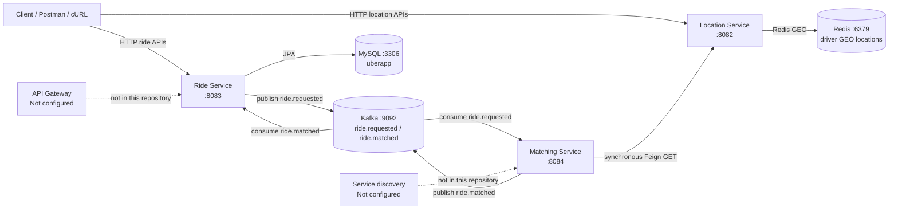

# UberApp — Ride-Sharing Microservices

UberApp is a Java/Spring Boot ride-booking backend prototype. It separates ride management, driver location storage, and driver matching into three independently runnable services. Ride requests and match results are exchanged asynchronously through Kafka; driver locations are stored in Redis, and ride records are stored in MySQL.

> **Scope note:** This README reflects the source and configuration currently in this repository. An API Gateway, service-discovery server, Swagger/OpenAPI setup, authentication, and Docker images for the Spring services are not configured. Services are accessed directly by their local ports.

## Contents

- [Architecture and request flow](#architecture-and-request-flow)
- [Services and project structure](#services-and-project-structure)
- [Technology stack](#technology-stack)
- [Prerequisites](#prerequisites)
- [Configuration](#configuration)
- [Installation and setup](#installation-and-setup)
- [Running the services](#running-the-services)
- [REST API reference](#rest-api-reference)
- [Testing the APIs](#testing-the-apis)
- [Databases and messaging](#databases-and-messaging)
- [Health checks and tests](#health-checks-and-tests)
- [Troubleshooting](#troubleshooting)
- [Future improvements](#future-improvements)

## Architecture and request flow



### Example ride request flow

1. A client submits `POST /api/v1/rides/request` to Ride Service.
2. Ride Service calculates an estimated fare, saves the ride in MySQL, publishes a `ride.requested` event, then sets the ride status to `MATCHING`. The HTTP response is returned without waiting for matching to finish.
3. Matching Service consumes `ride.requested` from Kafka and makes a synchronous OpenFeign call to Location Service's `GET /api/v1/locations/drivers/nearby` endpoint, searching within a fixed 5 km radius of the pickup point.
4. If candidates are returned, Matching Service selects one and publishes a `ride.matched` event.
5. Ride Service consumes `ride.matched`, stores the assigned driver ID, and changes the ride status to `ACCEPTED`.
6. The client can poll `GET /api/v1/rides/{rideId}` to see the updated status. There is no push notification or status-stream endpoint.

If no nearby drivers are returned, Matching Service logs and returns without publishing a match event. The ride remains `MATCHING`; a no-match status or timeout is not implemented.

## Services and project structure

```text
UberApp/
├── docker-compose.yml             # Redis, Zookeeper, Kafka infrastructure
├── API_ENDPOINTS.md                # Existing API inventory
├── ride-service/
│   ├── pom.xml
│   └── src/
│       ├── main/java/com/rideshare/ride_service/
│       │   ├── config/             # Kafka topic configuration
│       │   ├── controller/         # Ride REST endpoints and exception handler
│       │   ├── dto/                # Ride request/response payloads
│       │   ├── event/              # Kafka event payloads
│       │   ├── model/              # Ride entity and status enum
│       │   ├── repository/         # Spring Data JPA repository
│       │   └── service/            # Ride logic and Kafka consumer
│       ├── main/resources/         # application.yaml
│       └── test/                   # Spring Boot context test
├── location-service/
│   ├── pom.xml
│   └── src/
│       ├── main/java/com/rideshare/location_service/
│       │   ├── config/             # Redis configuration
│       │   ├── controller/         # Driver location REST endpoints
│       │   ├── dto/                # Location request/response payloads
│       │   └── service/            # Redis GEO operations
│       ├── main/resources/         # application.properties
│       └── test/                   # Spring Boot context test
└── matching-service/
    ├── pom.xml
    └── src/
        ├── main/java/com/rideshare/matching_service/
        │   ├── client/             # OpenFeign client for Location Service
        │   ├── dto/                # Nearby-driver payload
        │   ├── event/              # Kafka event payloads
        │   └── service/            # Matching logic and Kafka consumer
        ├── main/resources/         # application.yaml
        └── test/                   # Spring Boot context test
```

Each service is a separate Maven project with its own Spring Boot entry point and tests. Build artifacts in `target/` and IDE metadata are omitted from the structure above.

| Service | Responsibility | Port | Data / communication |
|---|---|---:|---|
| Ride Service | Creates rides, calculates estimated fares, tracks ride lifecycle, and processes driver matches | `8083` | MySQL; Kafka producer and consumer |
| Location Service | Updates, searches, and removes online driver locations | `8082` | Redis GEO |
| Matching Service | Consumes ride requests, queries nearby drivers, selects a candidate, and publishes a match | `8084` | Kafka; synchronous OpenFeign request to Location Service |

Matching Service does not expose a REST controller. It works in the background through Kafka.

## Technology stack

| Technology | Use in this project |
|---|---|
| Java 17 | Configured in all service Maven POM files |
| Spring Boot 4.0.8 | Application framework in each service |
| Spring Web | REST APIs in Ride and Location Services |
| Spring Data JPA / Hibernate | Ride persistence and schema update in MySQL |
| MySQL Connector/J | Ride Service JDBC driver |
| Spring Data Redis | Driver GEO storage and nearby lookup |
| Spring for Apache Kafka | Asynchronous ride-request and match events |
| Spring Cloud OpenFeign (Spring Cloud BOM 2025.1.2) | Matching Service's synchronous Location Service client |
| Spring Boot Actuator | Health/info endpoints |
| Lombok | Boilerplate reduction |
| Maven | Independent service builds; Maven Wrapper scripts are present |
| Docker Compose | Local Redis, Zookeeper, and Kafka infrastructure |

No Gradle build, service registry (such as Eureka), API Gateway, OpenAPI/Swagger dependency, or Spring-service Dockerfile is present.

## Prerequisites

- JDK 17.
- Maven installed and available as `mvn`. Wrapper scripts are checked in, but the wrapper JAR is absent and ignored by the repository's `.gitignore`; use installed Maven unless you have restored/generated that JAR.
- Docker Engine with Docker Compose v2 for Redis, Kafka, and Zookeeper.
- A MySQL 8-compatible server reachable at `localhost:3306` (or update Ride Service configuration).
- Ports `2181`, `3306`, `6379`, `8082`, `8083`, `8084`, and `9092` available as needed.

## Configuration

The current values are local-development defaults:

| Service | Setting | Default |
|---|---|---|
| Ride Service | HTTP port | `8083` |
| Ride Service | JDBC URL | `jdbc:mysql://localhost:3306/uberapp` |
| Ride Service | MySQL username / password | `root` / `admin` |
| Ride Service | Kafka bootstrap server | `localhost:9092` |
| Location Service | HTTP port | `8082` |
| Location Service | Redis host / port | `localhost` / `6379` |
| Matching Service | HTTP port | `8084` |
| Matching Service | Kafka bootstrap server | `localhost:9092` |
| Matching Service | Location Service URL | `http://localhost:8082` |

Configuration files:

- `ride-service/src/main/resources/application.yaml`
- `location-service/src/main/resources/application.properties`
- `matching-service/src/main/resources/application.yaml`

Spring Boot environment variables or command-line arguments can override these properties. For example:

```powershell
$env:SPRING_DATASOURCE_URL = "jdbc:mysql://localhost:3306/uberapp"
$env:SPRING_DATASOURCE_USERNAME = "root"
$env:SPRING_DATASOURCE_PASSWORD = "admin"
$env:SPRING_KAFKA_BOOTSTRAP_SERVERS = "localhost:9092"
$env:SPRING_DATA_REDIS_HOST = "localhost"
$env:LOCATION_SERVICE_URL = "http://localhost:8082"
```

These are not environment-variable placeholders declared in the config files; they are standard Spring Boot property overrides. Do not use the committed development password for a deployed environment.

Ride Service uses `spring.jpa.hibernate.ddl-auto: update`, so Hibernate creates/updates its tables when it connects. The project does not define a database migration tool or production schema workflow.

## Installation and setup

Run these commands from the repository root in PowerShell.

1. Clone the repository and enter it:

   ```powershell
   git clone https://github.com/Het836/UberApp.git
   Set-Location .\UberApp
   ```

2. Start Redis, Zookeeper, and Kafka. The Compose file does **not** start the Spring services:

   ```powershell
   docker compose up -d redis zookeeper kafka
   docker compose ps
   ```

3. Start MySQL separately. The MySQL service block in `docker-compose.yml` is commented out. This command creates the `uberapp` database and matches Ride Service's configured root password:

   ```powershell
   docker run --name mysql-rideshare `
     -e MYSQL_ROOT_PASSWORD=admin `
     -e MYSQL_DATABASE=uberapp `
     -p 3306:3306 `
     -v mysql-data:/var/lib/mysql `
     -d mysql:8.0
   ```

   If a container named `mysql-rideshare` already exists, start it with `docker start mysql-rideshare` instead. For an existing MySQL installation, create the database with `CREATE DATABASE uberapp;` and configure the username/password in Ride Service as required.

4. Build all three services independently:

   ```powershell
   Push-Location .\ride-service
   mvn clean package
   Pop-Location

   Push-Location .\location-service
   mvn clean package
   Pop-Location

   Push-Location .\matching-service
   mvn clean package
   Pop-Location
   ```

The repository root is not a Maven parent/aggregator project, so Maven commands must be run within each service directory.

## Running the services

Keep the infrastructure running and use a separate terminal for each service. Start infrastructure first, then Ride Service (which declares the Kafka topics), Location Service, and Matching Service. All services should be running before submitting a ride.

```powershell
# Terminal 1: Ride Service
Set-Location .\ride-service
mvn spring-boot:run
```

```powershell
# Terminal 2: Location Service
Set-Location .\location-service
mvn spring-boot:run
```

```powershell
# Terminal 3: Matching Service
Set-Location .\matching-service
mvn spring-boot:run
```

To run a packaged service instead, build it in that service directory and run:

```powershell
java -jar .\target\ride-service-0.0.1-SNAPSHOT.jar
```

Replace `ride-service` in the JAR filename for the other modules. To stop the infrastructure:

```powershell
docker compose down
docker stop mysql-rideshare
```

The named MySQL volume is retained when the container is stopped. No API Gateway or service discovery is involved; clients use the service URLs directly, and Matching Service uses the configured Location Service URL.

## REST API reference

All paths below are relative to the service base URL. No authentication is configured in these services. The service controllers do not define Swagger UI, so use the examples below or the checked-in [`API_ENDPOINTS.md`](API_ENDPOINTS.md).

### Ride Service — `http://localhost:8083`

#### `POST /api/v1/rides/request`

Create and persist a ride, compute its estimated fare, and publish a match request.

Request:

```json
{
  "riderId": "rider-456",
  "pickupLatitude": 12.9716,
  "pickupLongitude": 77.5946,
  "pickupAddress": "MG Road, Bengaluru",
  "dropLatitude": 12.9352,
  "dropLongitude": 77.6245,
  "dropAddress": "Koramangala, Bengaluru"
}
```

Success: `201 Created`, with a `RideResponse` such as:

```json
{
  "id": "generated-ride-id",
  "riderId": "rider-456",
  "driverId": null,
  "pickupLatitude": 12.9716,
  "pickupLongitude": 77.5946,
  "pickupAddress": "MG Road, Bengaluru",
  "dropLatitude": 12.9352,
  "dropLongitude": 77.6245,
  "dropAddress": "Koramangala, Bengaluru",
  "status": "MATCHING",
  "estimatedFare": 112.0,
  "actualFare": 0.0,
  "createdAt": "2026-11-11T11:09:03",
  "updatedAt": null,
  "startedAt": null,
  "completedAt": null
}
```

IDs, timestamps, and fare are generated at runtime. Fare is `50 + 12 × straight-line distance in km`, rounded to two decimals. `riderId` must be non-blank. Validation/runtime failures handled by Ride Service return `400` with a JSON error map.

#### `GET /api/v1/rides/{rideId}`

Get one ride by its ride ID (the controller parameter is named `riderId`, but it is used as the ride ID). Returns `200 OK` with a `RideResponse`. A missing ride returns `400` with `{"error":"Ride not found"}`.

#### `GET /api/v1/rides/rider/{riderId}`

Get a rider's rides in newest-first order. Returns `200 OK` with an array of `RideResponse`; no rides returns `[]`.

#### `PUT /api/v1/rides/{rideId}/start`

Start a ride; the current status must be `ACCEPTED`. No request body. Returns `200 OK` with the updated `RideResponse`, or `400` with an error object if the ride is missing or in the wrong status.

#### `PUT /api/v1/rides/{rideId}/complete`

Complete a ride; the current status must be `RIDE_STARTED`. Sets `completedAt` and copies the estimated fare to `actualFare`. No request body. Returns `200 OK` with the updated `RideResponse`.

#### `PUT /api/v1/rides/{rideId}/cancel`

Cancel a ride. No request body. The current service does not enforce a status restriction on cancellation. Returns `200 OK` with the updated `RideResponse`.

Ride lifecycle statuses defined in the source are `REQUESTED`, `MATCHING`, `ACCEPTED`, `DRIVER_ARRIVING`, `RIDE_STARTED`, `COMPLETED`, and `CANCELLED`. `DRIVER_ARRIVING` currently has no implemented transition.

### Location Service — `http://localhost:8082`

#### `POST /api/v1/locations/drivers/update`

Add or update a driver's location in Redis. The source comment describes periodic driver updates.

Request:

```json
{
  "driverId": "driver-123",
  "latitude": 12.9716,
  "longitude": 77.5946
}
```

Returns `200 OK` with the plain-text response `Driver location updated successfully`.

#### `GET /api/v1/locations/drivers/nearby`

Find up to 10 nearby drivers, nearest first.

| Query parameter | Required | Meaning |
|---|---|---|
| `latitude` | Yes | Search center latitude |
| `longitude` | Yes | Search center longitude |
| `radius` | No | Search radius in km; defaults to `5.0` |

Example:

```text
GET http://localhost:8082/api/v1/locations/drivers/nearby?latitude=12.9716&longitude=77.5946&radius=5
```

Returns `200 OK` with a JSON array, for example:

```json
[
  {
    "driverId": "driver-123",
    "latitude": 77.5946,
    "longitude": 12.9716,
    "distanceInKm": 0.42
  }
]
```

**Known coordinate issue:** The current implementation stores points as `(longitude, latitude)` correctly, but builds the response by assigning Redis X to `latitude` and Y to `longitude`. Thus the example reflects the current response for a driver whose input was latitude `12.9716`, longitude `77.5946`; the returned coordinate fields are reversed and should not be used as correct map coordinates until fixed. An empty result is `[]`.

#### `DELETE /api/v1/locations/drivers/{driverId}`

Remove a driver from the Redis GEO set. Example: `DELETE http://localhost:8082/api/v1/locations/drivers/driver-123`. Returns `200 OK` with the plain-text response `Driver Removed Successfully`.

### Matching Service — `http://localhost:8084`

There are no REST endpoints or REST controller in this service. It consumes and publishes Kafka events and calls Location Service internally.

## Testing the APIs

You can use Postman by importing the URLs and JSON bodies below. Swagger UI is not configured in the project.

### PowerShell (`curl.exe`)

Update a driver's location:

```powershell
curl.exe -i -X POST "http://localhost:8082/api/v1/locations/drivers/update" `
  -H "Content-Type: application/json" `
  -d '{"driverId":"driver-123","latitude":12.9716,"longitude":77.5946}'
```

List nearby drivers:

```powershell
curl.exe "http://localhost:8082/api/v1/locations/drivers/nearby?latitude=12.9716&longitude=77.5946&radius=5"
```

Request a ride:

```powershell
curl.exe -i -X POST "http://localhost:8083/api/v1/rides/request" `
  -H "Content-Type: application/json" `
  -d '{"riderId":"rider-456","pickupLatitude":12.9716,"pickupLongitude":77.5946,"pickupAddress":"MG Road, Bengaluru","dropLatitude":12.9352,"dropLongitude":77.6245,"dropAddress":"Koramangala, Bengaluru"}'
```

Copy the returned `id` and use it to inspect the ride. Allow time for Kafka matching before expecting `ACCEPTED`:

```powershell
curl.exe "http://localhost:8083/api/v1/rides/generated-ride-id"
curl.exe "http://localhost:8083/api/v1/rides/rider/rider-456"
curl.exe -i -X PUT "http://localhost:8083/api/v1/rides/generated-ride-id/start"
curl.exe -i -X PUT "http://localhost:8083/api/v1/rides/generated-ride-id/complete"
curl.exe -i -X PUT "http://localhost:8083/api/v1/rides/generated-ride-id/cancel"
curl.exe -i -X DELETE "http://localhost:8082/api/v1/locations/drivers/driver-123"
```

The start and complete calls must be made in order and only after the ride has reached the required status. Ride Service exposes Actuator health at `http://localhost:8083/actuator/health`; the corresponding paths for Location and Matching Service are on ports `8082` and `8084`.

## Databases and messaging

| Component | Used by | Details |
|---|---|---|
| MySQL | Ride Service | Database `uberapp`; table `rides` is mapped from the `Ride` entity. Hibernate `ddl-auto: update` manages development schema changes. |
| Redis | Location Service | Redis GEO set key `drivers:locations`; coordinates are added, searched within a radius, and removed using driver IDs. |
| Kafka | Ride and Matching Services | Ride Service publishes `ride.requested` and consumes `ride.matched`; Matching Service consumes `ride.requested` and publishes `ride.matched`. |
| Zookeeper | Local Kafka container | Used by the configured Confluent Kafka image in `docker-compose.yml`. |

Ride Service's Kafka configuration declares both topics with three partitions and one replica. The Compose broker enables automatic topic creation. These settings are for local single-broker development, not a resilient production deployment.

The Compose file starts Redis, Zookeeper, and Kafka only. Its MySQL service definition is commented out, and there are no Compose definitions for the Java applications.

## Health checks and tests

Actuator `health` and `info` endpoints are configured in Ride and Matching Services. Location Service includes Actuator, but its config uses `management.endpoint.web.exposure.include` (singular `endpoint`), whereas Spring Boot's standard property is `management.endpoints.web.exposure.include`; its health endpoint may therefore not be exposed until that property is corrected. The intended path is `/actuator/health` on each service port.

Run tests per service:

```powershell
Push-Location .\ride-service
mvn test
Pop-Location

Push-Location .\location-service
mvn test
Pop-Location

Push-Location .\matching-service
mvn test
Pop-Location
```

Each module currently contains a basic Spring Boot context-load test; no dedicated API or integration-test suite is configured.

## Troubleshooting

| Symptom | Likely cause and resolution |
|---|---|
| Service fails to start on its HTTP port | Port `8082`, `8083`, or `8084` is occupied. Stop the conflicting process or override `SERVER_PORT` for that service. |
| Ride Service reports a MySQL connection error | Start MySQL, ensure `uberapp` exists, and check `SPRING_DATASOURCE_URL`, `SPRING_DATASOURCE_USERNAME`, and `SPRING_DATASOURCE_PASSWORD`. The Compose MySQL block is commented out. |
| Kafka connection refused / bootstrap timeout | Ensure Zookeeper and Kafka containers are running (`docker compose ps`) and broker `localhost:9092` is reachable before starting Ride or Matching Service. Check `docker compose logs kafka` for broker startup errors. |
| Matching Service cannot call Location Service | Start Location Service on `8082`, check Redis is available, and confirm `LOCATION_SERVICE_URL` points to the reachable Location Service address. |
| Nearby driver lookup returns `[]` | First post driver coordinates using the location update endpoint; check the search center and radius. |
| A ride remains in `MATCHING` | Check Matching Service logs and Kafka connectivity, then ensure at least one driver is in Redis within the fixed 5 km search radius. No-match handling and retry/timeout behavior are not implemented. |
| Ride start/complete returns `400` | Start is allowed only after `ACCEPTED`; complete is allowed only after `RIDE_STARTED`. Poll the ride status before advancing it. |
| `mvnw.cmd` cannot find the wrapper main class | The wrapper JAR is not included in this repository. Install Maven and use `mvn`, or restore the Maven Wrapper JAR. |
| Browser frontend is blocked by CORS | No CORS configuration is present. Use a same-origin development proxy or add an explicit CORS policy for the frontend origin. |

## Future improvements

- Add an API Gateway and service discovery if deployment needs centralized routing and dynamic service lookup.
- Correct the nearby-driver latitude/longitude response mapping and add coordinate/range validation.
- Add no-driver outcomes, timeouts, retry policies, and dead-letter handling for Kafka processing.
- Add authentication/authorization, CORS policy, and request rate limits.
- Add OpenAPI documentation and API/integration tests.
- Move secrets and environment-specific settings to managed configuration; use database migrations rather than Hibernate schema updates.
- Add Dockerfiles and a complete Compose profile with health checks and explicit service readiness dependencies.
- Add a client-facing push channel or status-history API if live ride tracking is required.
